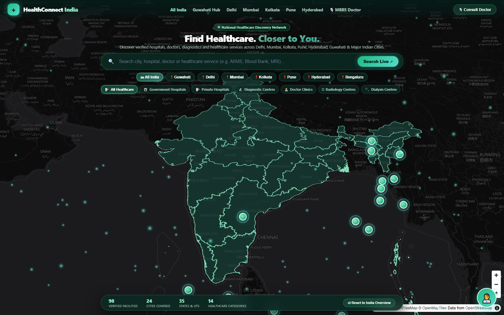
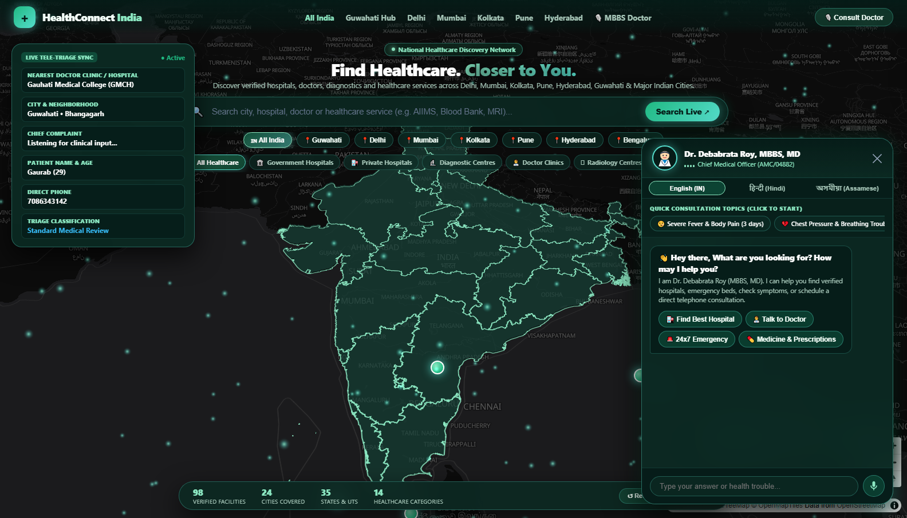
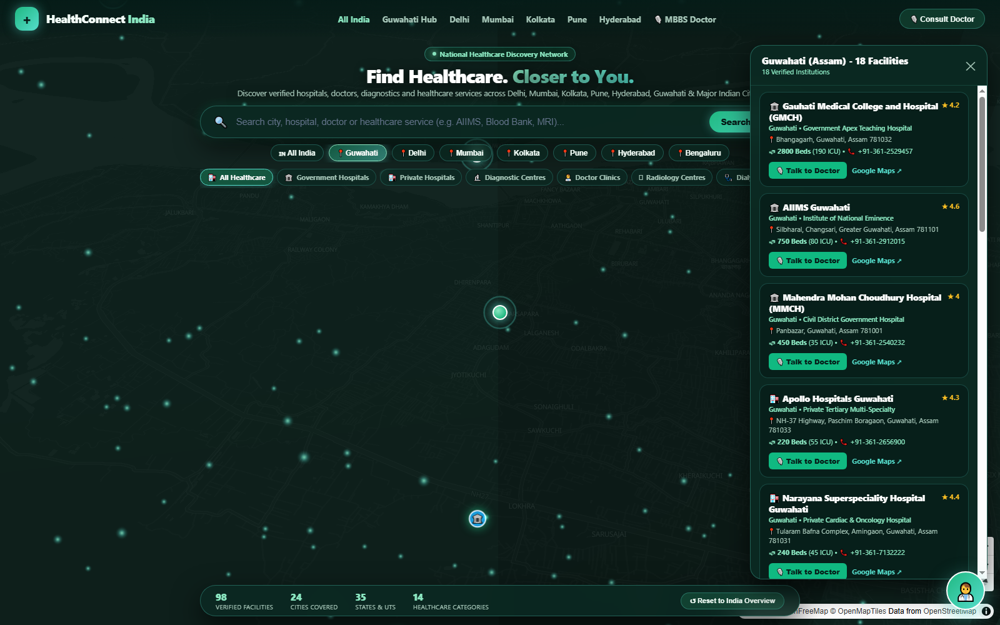
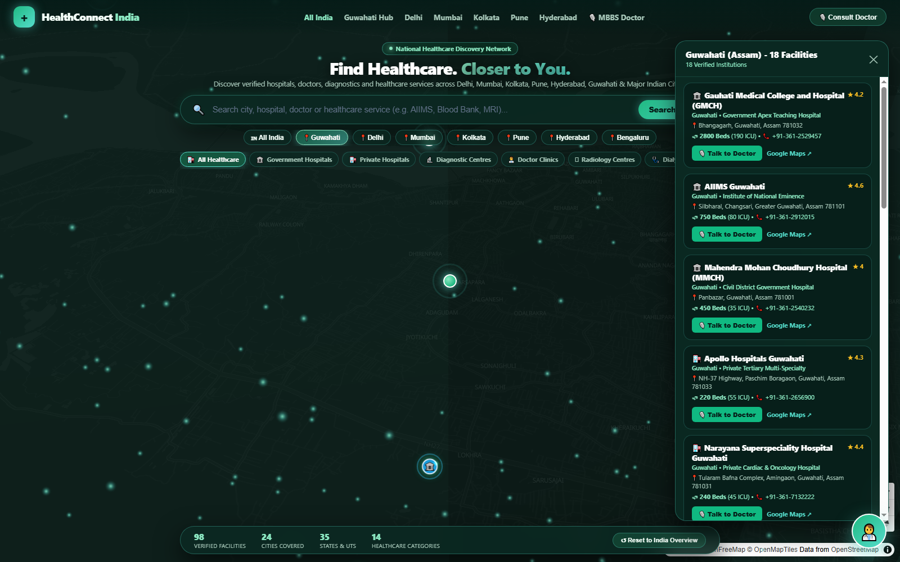
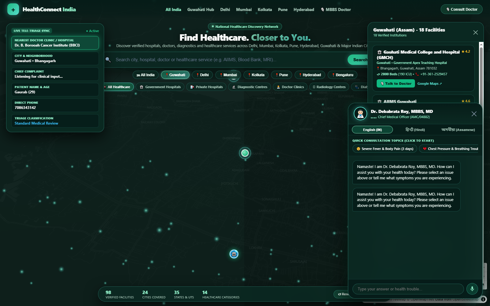
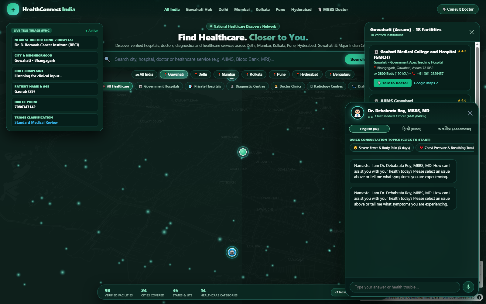
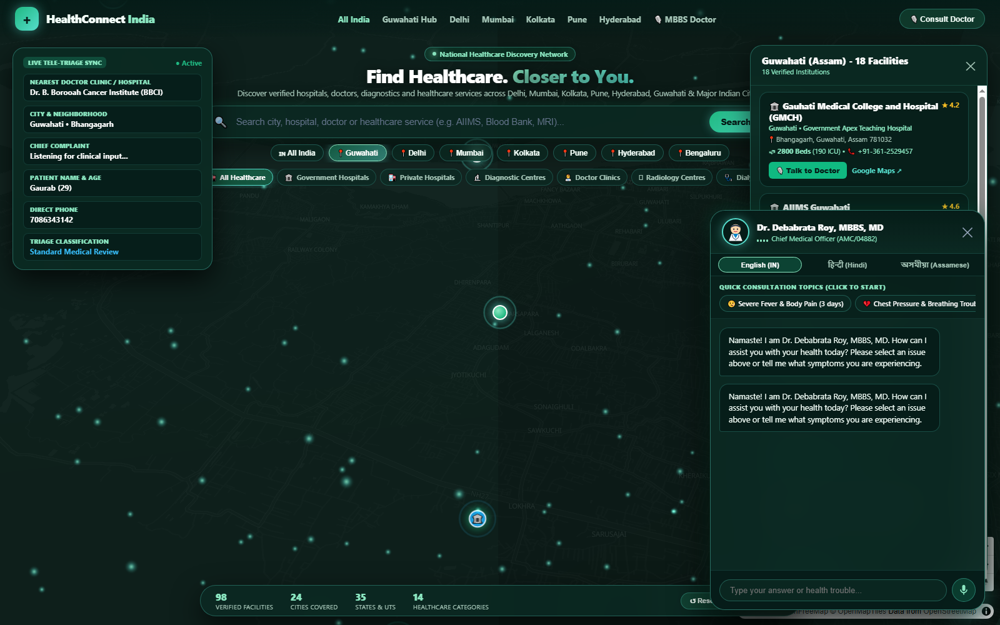

# 🏥 MedConnect India

> **Interactive 3D Glass India Healthcare Map & Live Discovery Platform with Trilingual Doctor AI**

MedConnect India is a next-generation healthcare discovery platform delivering accurate local healthcare information, verified government & private institutions, transparent consultation and diagnostic coordination, and an interactive trilingual Clinical AI Doctor (Dr. Debabrata Roy, MBBS, MD) with real-time telephone calling simulation.

---

## 🌟 Key Features

### 1. 🌐 Interactive 3D Emerald Glass Map of India
- Built on **MapLibre GL JS** and **Three.js** with high-resolution vector tiles.
- Futuristic dark emerald-green glassmorphism aesthetic (`#061C18` primary background, glowing state boundaries, translucent glass layer).
- Smooth 3D camera controls, pitch, and bearing with ambient atmospheric particles.
- Real-time geographical hover cards displaying state-level healthcare infrastructure and verified institution counts.

### 2. 🔍 Live Multi-Category Healthcare Discovery Engine
- **98+ Verified Healthcare Facilities** mapped with exact GPS coordinates across major Indian cities:
  - **Guwahati (Assam)**: GMCH, AIIMS Guwahati, Dr. B. Borooah Cancer Institute, Narayana Superspeciality, Apollo Hospitals, GNRC Dispur, Hayat Hospital, Excelcare, etc.
  - **New Delhi / NCR**: AIIMS New Delhi, Safdarjung, Fortis Escorts, Max Super Speciality Saket, Sir Ganga Ram, Apollo Indraprastha, Medanta.
  - **Mumbai**: Tata Memorial Centre, KEM Hospital, Lilavati Hospital, Kokilaben Dhirubhai Ambani, Hinduja, Nanavati.
  - **Kolkata**: IPGMER & SSKM, AMRI Dhakuria, Apollo Gleneagles, Fortis Anandapur, Woodlands.
  - **Pune**: Ruby Hall Clinic, Jehangir Hospital, Deenanath Mangeshkar, Sahyadri Super Speciality.
  - **Hyderabad**: NIMS, Apollo Jubilee Hills, Yashoda Secunderabad, KIMS Hospital.
  - **Bengaluru**: NIMHANS, Manipal Hospital, Narayana Health City, Fortis Cunningham Rd.
- **14 Healthcare Categories**:
  - Government Hospitals & Medical Colleges
  - Private Multi-Specialty & Super-Specialty
  - Specialized Cancer Care Institutes
  - 24x7 Trauma & Emergency Units
  - Specialized Cardiac Care Centres
  - Diagnostic & Imaging Laboratories
  - Dialysis & Nephrology Centres
  - 24x7 Blood Banks
  - Registered Retail & Hospital Pharmacies
  - Eye Care & Ophthalmology Hospitals
  - Maternity & Pediatric Care
  - Orthopedic & Joint Centers
  - Ayurvedic & AYUSH Centers
  - Home Healthcare Services

### 3. 👨‍⚕️ Trilingual Interactive Doctor AI & Voice Agent
- **Doctor Profile**: Dr. Debabrata Roy (MBBS, MD - Chief Clinical Officer).
- **Trilingual Speech & Text**: Seamlessly communicates in **English (IN)**, **हिन्दी (Hindi)**, and **অসমীয়া (Assamese)**.
- **Natural Voice Recognition & Speech Synthesis**: Uses the Web Speech API with native Indian accent voice selection and hands-free microphone input.
- **Interactive Triage & Registration**: Gathers patient vitals, symptoms, locality, and preferred language with dynamic registration card updates on-screen.

### 4. 📞 Real-Time Doctor Telephone Call Simulation
- **Synthesized Dual-Tone Ringing**: Web Audio API generates realistic standard telecom ringing tones (400Hz + 450Hz).
- **Human-Tone Clinical Consultation**:
  - Empathic conversational tone addressing patient fears and urgency.
  - Formulates medical solutions with exact pharmaceutical dosages (e.g. Paracetamol 650mg, Pantoprazole 40mg, ORS).
  - Prescribes evidence-based dietary recommendations (khichdi, hydration, avoiding spicy foods).
  - Automatically identifies user locality (e.g. Paltan Bazaar, Dispur, Khanapara in Guwahati; Connaught Place, Saket in Delhi; Andheri, Bandra in Mumbai) and pinpoints the nearest clinic.
  - Dynamically commands the 3D map to fly to street-level zoom (`15.6`) centered on the recommended facility.

---

## 📸 Working Feature Showcase

### 1. Interactive 3D Emerald Glass India Healthcare Map
Futuristic dark emerald aesthetic, glowing state boundaries, atmospheric particle field, and instant city switcher pills tray.


### 2. Proactive AI Doctor Sweet Voice Greeting & Interactive Welcome
Proactive audio greeting ("Hey there, What are you looking for? How may I help you") in a warm, sweet tone with animated floating pill and one-click quick action chips.


### 2. City Deep-Dive & Verified Facility Pinpointing (Guwahati, Assam)
Zoom-in navigation displaying verified institutions with live emergency status, bed counts, and Google Maps routing.


### 3. Verified Institution Details & Direct Doctor Referral
Comprehensive clinical capability cards with ICU beds, blood bank status, direct desk numbers, and "Talk to Doctor" initiation.


### 4. Live Multi-Category Healthcare Search & Autocomplete
Instant search across 98+ verified hospitals, specialty clinics, diagnostics, and categories with keyboard navigation.


### 5. Trilingual Clinical Voice & Chatbot (Assamese, Hindi, English)
Dr. Debabrata Roy (MBBS, MD) conducting preliminary clinical consultation in native language with voice synthesis and speech input.


### 6. Real-Time Patient Triage & Clinical Intake Sync
Live on-screen patient registration and clinical triage card automatically formulating symptoms and urgent triage levels.


### 7. Dual-Tone Telephone Ringing Simulation
Web Audio API synthesized 400Hz + 450Hz telecom ringing incoming call screen connecting the patient directly to the attending physician.


### 8. Live Doctor Telephone Consultation & Neighborhood Clinic Routing
Empathic voice consultation, evidence-based pharmaceutical prescriptions with dosages, dietary modifications, and automatic 3D map fly-to on the nearest neighborhood clinic.


---

- **GitHub Pages**: [https://bookallot.github.io/MedConnect/](https://bookallot.github.io/MedConnect/)
- **Local Development**:
  ```bash
  # Clone repository
  git clone https://github.com/bookallot/MedConnect.git
  cd MedConnect

  # Install backend dependencies (optional for local API mode)
  npm install

  # Start the server
  npm start
  # Access at http://localhost:5000
  ```

---

## 🛠 Tech Stack

- **Frontend**: Vanilla ES6+, MapLibre GL JS, Three.js, Web Speech API, Web Audio API, Canvas.
- **Map Tiles**: OpenFreeMap Vector Dark Style (`https://tiles.openfreemap.org/styles/dark`).
- **Data Layers**: GeoJSON boundaries enriched with live healthcare facility density.
- **Backend**: Node.js, Express.js, Prisma ORM (optional SQL persistence).

---

## 📜 License

MIT License © 2026 MedConnect India.
